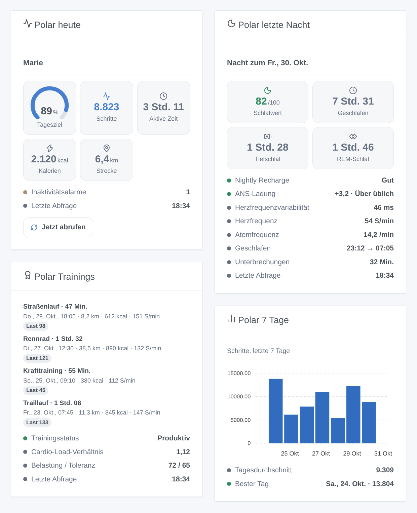
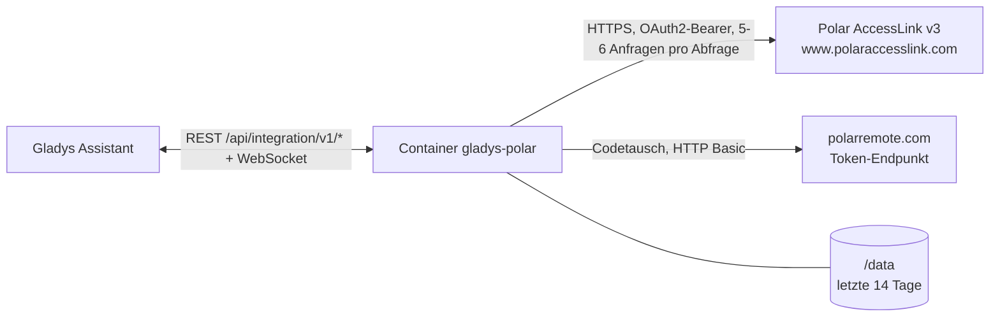
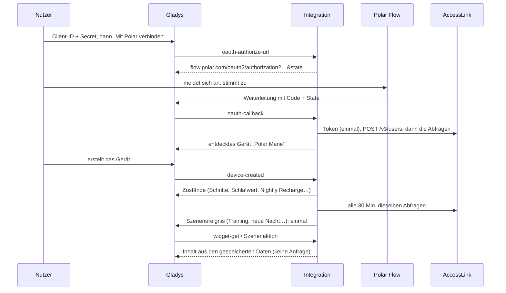

# Gladys Polar

[English](README.md) · [Français](README.fr.md) · **Deutsch** · [Español](README.es.md)

[](LICENSE)
[](https://github.com/William-De71/gladys-polar/releases)
[](https://github.com/William-De71/gladys-polar/actions/workflows/release.yml)
[](https://gladysassistant.com)


Externe [Gladys-Assistant](https://gladysassistant.com)-Integration für **Polar-Uhren und Herzfrequenzsensoren**, über die offizielle [Polar-AccessLink](https://www.polar.com/accesslink-api/)-API und deinen eigenen API-Client. Heutige Aktivität, letzte Nacht, Nightly Recharge, Trainings und Cardio Load werden zu einem Gerät, Dashboard-Widgets und Szenenauslösern.

Benutzerdokumentation: [English](docs/en.md) · [Français](docs/fr.md) · [Deutsch](docs/de.md) · [Español](docs/es.md).

> Community-Integration, nicht mit Polar Electro verbunden, nicht von Polar unterstützt oder gesponsert. Polar, Polar Flow und Nightly Recharge sind Marken der Polar Electro Oy. Bisher nicht mit einem echten Polar-Konto getestet: Jede Antwortstruktur stammt aus der AccessLink-Dokumentation.

## Funktionen

- **Ein Gerät pro verknüpftem Polar-Flow-Konto**: Schritte, aktive Zeit, Kalorien, Strecke und Tagesziel; Schlafwert und Schlafdauer; Nightly-Recharge-Status, ANS-Ladung, Herzfrequenzvariabilität, Herz- und Atemfrequenz; Cardio-Load-Status und -Verhältnis.
- **Vier Widgets**: heute (mit Abruf-Taste), letzte Nacht, Trainings, letzte sieben Tage.
- **Vier Szenenauslöser** und **eine Szenenaktion** (siehe unten).
- **OAuth 2.0 mit deinem eigenen AccessLink-Client**; der Autorisierungscode wird nie zweimal gesendet (Polar löscht sonst alle Tokens).
- **Cloud**, Abfrage alle 15 bis 120 Minuten, Anfragelimits eingehalten, Daten in `/data`.
- Englisch, Französisch, Deutsch und Spanisch überall.



## Funktionsweise




Der Nutzer legt auf admin.polaraccesslink.com einen API-Client mit der Weiterleitungs-URL von Gladys an. „Mit Polar verbinden“ öffnet Polar Flow; Gladys reicht den Code weiter, und die Integration tauscht ihn genau einmal am Token-Endpunkt (HTTP Basic `client_id:client_secret`, ohne PKCE und Refresh-Token, ein Token gilt etwa ein Jahr) und registriert den Nutzer beim Client (`POST /v3/users`). Jede Abfrage nutzt die nicht-transaktionalen Endpunkte: Tagesaktivität (heute und die 7 Tage davor), Trainings (30 Tage), Nächte, Nightly Recharge, Cardio Load und zweimal täglich die Körperdaten. Die Webhooks von Polar werden nicht genutzt: Sie brauchen eine öffentliche URL, die Polars Ping beantwortet, und signierte Anfragen, deren Header Gladys Plus nicht weitergibt.



### Transport

Nur Cloud (`"transports": ["cloud"]`): Der Katalog zeigt das Cloud-Abzeichen. Deine Polar-Daten gehen über das Internet von Polars Servern zu deinem Gladys, mit deinem eigenen Client; nichts läuft über einen Drittserver. Es gibt keinen lokalen Zugang, daher keine Taste „Lokale Verbindung bevorzugen“.

## Geräte und Funktionen

| Funktion                         | Kategorie / Typ               | Einheit       |
| -------------------------------- | ----------------------------- | ------------- |
| Schritte heute                   | `counter-sensor` / `integer`  | —             |
| Aktive Zeit heute                | `duration` / `integer`        | Minuten       |
| Kalorien heute (kcal)            | `counter-sensor` / `integer`  | —             |
| Strecke heute                    | `distance-sensor` / `decimal` | km            |
| Tägliches Aktivitätsziel         | `level-sensor` / `decimal`    | %             |
| Schlafwert                       | `counter-sensor` / `integer`  | —             |
| Schlafdauer                      | `duration` / `decimal`        | Stunden       |
| Nightly-Recharge-Status (1-6)    | `counter-sensor` / `integer`  | —             |
| ANS-Ladung (-10 bis +10)         | `level-sensor` / `decimal`    | —             |
| Herzfrequenzvariabilität (Nacht) | `duration` / `integer`        | Millisekunden |
| Herzfrequenz nachts              | `counter-sensor` / `integer`  | —             |
| Atemfrequenz                     | `level-sensor` / `decimal`    | —             |
| Cardio-Load-Verhältnis           | `level-sensor` / `decimal`    | —             |
| Cardio-Load-Status               | `text` / `text`               | —             |

Gladys hat weder eine Gesundheitskategorie noch Einheiten für Schritte, Kalorien, Herzfrequenz oder Gewicht: Zählwerte nutzen `counter-sensor` ohne Einheit (die Einheit steht im Namen), Dauern `duration`, und das Gewicht ist nur eine Ausgabe der Szenenaktion. Die Geräte-ID stammt aus der Polar-Nutzer-ID (`x_user_id`), nie aus einem Namen.

## Szenenauslöser, Aktionen und Widgets

| Art      | Schlüssel                    | Verwendung                                                       |
| -------- | ---------------------------- | ---------------------------------------------------------------- |
| Auslöser | `exercise_synced`            | ein neues Training (Filter: Sportfamilie)                        |
| Auslöser | `sleep_available`            | die Nacht der letzten zwei Tage, mit Wert und Phasen             |
| Auslöser | `nightly_recharge_available` | die Nightly Recharge der letzten zwei Tage (Filter: Status 1-6)  |
| Auslöser | `daily_goal_reached`         | 100 % des Aktivitätsziels, einmal pro Tag                        |
| Aktion   | `get_summary`                | die letzten Werte (20 Ausgaben, inklusive Gewicht), ohne Anfrage |
| Widget   | `today`                      | Zielanzeige, Schritte, aktive Zeit, Kalorien, Strecke, Abruf     |
| Widget   | `night`                      | Schlafwert, Dauer, Tief- und REM-Schlaf, Nightly Recharge        |
| Widget   | `exercises`                  | die letzten Trainings und der Trainingsstatus                    |
| Widget   | `week`                       | Schritte, aktive Zeit oder Schlafwert der letzten sieben Tage    |

Beispiele: **neue Nacht** → die Zusammenfassung aufs Handy schicken; **Nightly Recharge** Status 1 oder 2 → sanfteres Morgenlicht; **Training synchronisiert** (Laufen) → Handtuchheizkörper einschalten.

## Voraussetzungen

- Gladys Assistant **5.3.0** oder neuer (Katalog-Schlüsselwörter von Gladys 5.3, Widgets und Szenen externer Integrationen). Ältere Instanzen können die Integration nicht installieren.
- Ein Polar-Flow-Konto und ein Polar-Gerät, das damit synchronisiert.
- Ein kostenloser AccessLink-API-Client auf [admin.polaraccesslink.com](https://admin.polaraccesslink.com) mit `https://my.gladysassistant.com/redirect/oauth` als Weiterleitungs-URL.

## Installation

- **Aus dem Store** von Gladys (Integrationen → Externe Integrationen), mit einem Klick, sobald indiziert.
- **Über die Repository-URL**: `https://github.com/William-De71/gladys-polar`.
- **Entwicklermodus**: Image lokal bauen (`docker build -t gladys-polar .`) und in Gladys installieren.

## Konfiguration

| Feld                | Beschreibung                                                                   |
| ------------------- | ------------------------------------------------------------------------------ |
| Client-ID           | Die Client-ID deines AccessLink-Clients.                                       |
| Client-Secret       | Sein Secret (geheimes Feld, nie protokolliert).                                |
| Mit Polar verbinden | Verknüpft das Konto (Scope `accesslink.read_all`, nur Lesen).                  |
| Abfrageintervall    | 15, 30 (Standard), 60 oder 120 Minuten.                                        |
| Sprache der Texte   | Gerätenamen, Cardio-Load-Status und Szenentexte (automatisch: dein Dashboard). |

Tasten: **Jetzt abrufen**, **Polar-Konto trennen** (`DELETE /v3/users/{id}`, das Token wird vergessen) und **Diagnose** (schreibt einen anonymisierten Zustand in den Tab Protokolle).

## Verwendung

1. AccessLink-Client anlegen, Client-ID und Secret einfügen, speichern, **Mit Polar verbinden** klicken.
2. Im Tab **Entdecken** das Gerät „Polar …“ erstellen.
3. Die Uhr mit Polar Flow synchronisieren (Polar teilt nur, was nach der Verknüpfung synchronisiert wird), Widgets zu einem Dashboard hinzufügen und Szenen bauen.

## Entwicklung

```bash
npm install
npm test                       # node --test, nie mit Netzwerkzugriff
npm run lint && npm run format:check
npx github:GladysAssistant/integration-store . --skip-image-check
scripts/build-cover.sh         # cover.jpg aus docs/assets/cover.svg
docs/illustrations/render.sh   # docs/assets/widgets.<lang>.png
node .github/scripts/release.mjs next
```

Lokal liest das SDK `GLADYS_HOST_API_URL`, `GLADYS_INTEGRATION_TOKEN` und `GLADYS_INTEGRATION_SELECTOR`; `TZ` legt „heute“ fest. `DEBUG=gladys-integration-sdk` zeigt die SDK-Protokolle und prüft jeden Widget-Inhalt. Die Tests nutzen ein falsches Polar und erfundene Antworten nach dem Muster der Dokumentation (`test/helpers/`). Die Regeln des Projekts stehen in [CLAUDE.md](CLAUDE.md).

## Release-Prozess


Jeder Merge auf `main` startet die CI und berechnet dann die Version aus den [Conventional Commits](https://www.conventionalcommits.org/) seit dem letzten Tag: `feat` → Minor, `fix` / `perf` → Patch, `!` oder `BREAKING CHANGE` → Major (Minor unter 1.0.0). `docs`, `chore`, `ci`, `test`, `style`, `refactor` und `build` allein veröffentlichen nichts. Der Workflow erzeugt den Changelog-Abschnitt, pusht den Tag und baut das Multi-Architektur-Image. Erst danach erhält `main` den Release-Commit und das GitHub Release wird erstellt. Ein letzter Job prüft das öffentliche Image, den Store-Validator und das Topic.

- Der Titel des Pull Requests wird zum Squash-Commit und dann zur Changelog-Zeile: auf Englisch, für den Nutzer (`pr-title.yml` prüft ihn). `CHANGELOG.md` nie von Hand bearbeiten.
- 1.0.0 ist eine Entscheidung: Actions → Release → Run workflow mit `release-as: 1.0.0`. `dry-run` zeigt Version und Notizen, ohne zu veröffentlichen.
- **Geschützter Branch**: Das Release pusht seinen Commit mit `GITHUB_TOKEN` auf `main`. Mit einem Ruleset auf `main`, das strenger ist als „kein Löschen, kein Force-Push“, GitHub Actions zur Bypass-Liste hinzufügen (oder über eine GitHub App pushen). Sonst scheitert der Veröffentlichungsjob mit einer Anleitung.
- Nach dem ersten Release das Paket auf `ghcr.io` öffentlich machen (Package settings → Change visibility), sonst kann Gladys es nicht laden.

## Fehlerbehebung

Siehe [docs/de.md](docs/de.md#fehlerbehebung). Melde Probleme mit den Versionen von Gladys und der Integration, dem Uhrmodell und den Zeilen der Taste **Diagnose**.

## Mitwirken

Issues und Pull Requests sind willkommen. Vor einem Pull Request `npm run format:check && npm run lint && npm test` ausführen und alle externen IDs und gespeicherten Schlüssel unverändert lassen (siehe [CLAUDE.md](CLAUDE.md)). Eine echte AccessLink-Antwort, die von der Dokumentation abweicht, ist als neuer Testfall sehr willkommen (vorher Namen und IDs entfernen).

## Sicherheit

Siehe [SECURITY.md](SECURITY.md): Schwachstellen bitte privat melden. Das Client-Secret ist ein geheimes Feld; Token und OAuth-Zustand sind interne Konfigurationsschlüssel, nie in `/data` oder in den Protokollen. Ein Autorisierungscode wird nie zweimal an Polar gesendet.

## Kommende Screenshots

Die Bilder oben sind Illustrationen, keine Screenshots. Echte Screenshots kommen nach `docs/assets/screenshots/` (PNG, 1280 × 800): `configuration.png`, `discovery.png`, `device.png`, `scene.png`.

## Lizenz

[Apache-Lizenz 2.0](LICENSE) — siehe auch [NOTICE](NOTICE). Die Daten stammen aus deinem Polar-Flow-Konto über die Polar-AccessLink-API, nach den AccessLink-Bedingungen von Polar. Danke an die Dokumentation und das SDK von Gladys.
