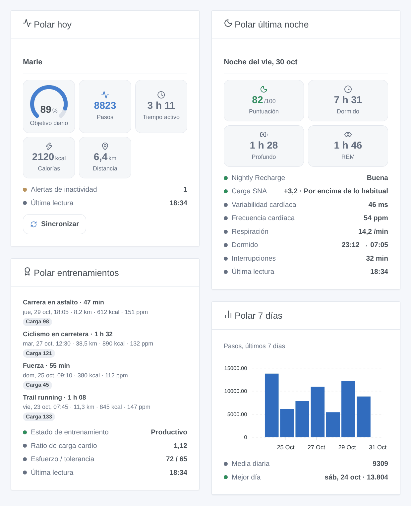
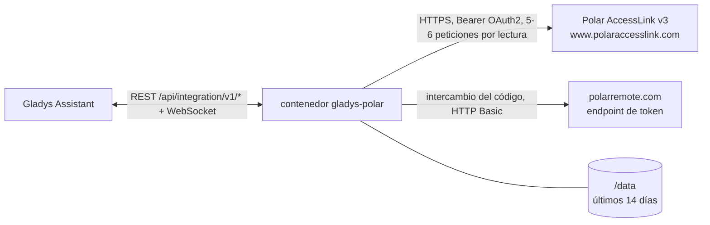
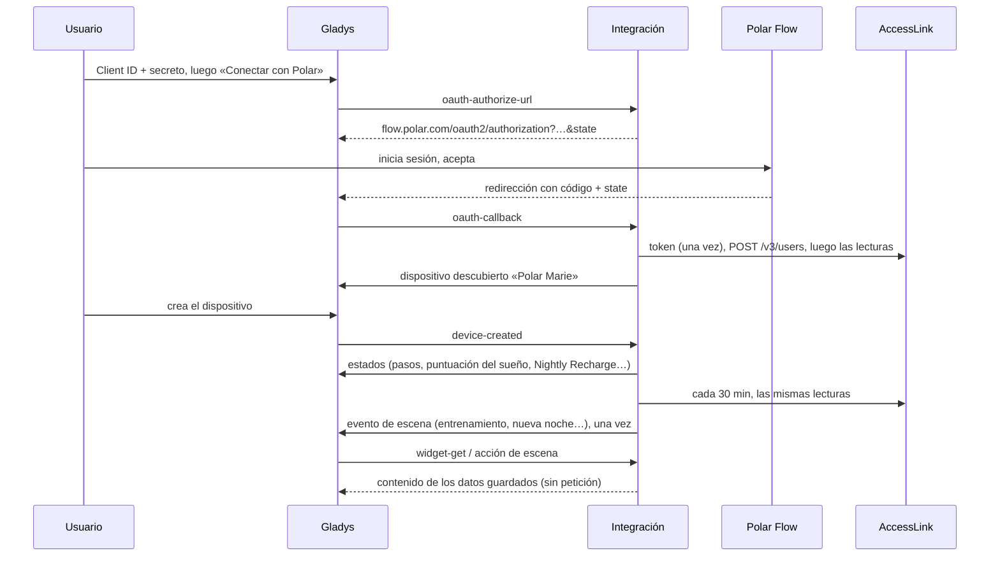

# Gladys Polar

[English](README.md) · [Français](README.fr.md) · [Deutsch](README.de.md) · **Español**

[](LICENSE)
[](https://github.com/William-De71/gladys-polar/releases)
[](https://github.com/William-De71/gladys-polar/actions/workflows/release.yml)
[](https://gladysassistant.com)


Integración externa de [Gladys Assistant](https://gladysassistant.com) para **relojes y sensores de frecuencia cardíaca Polar**, mediante la API oficial [Polar AccessLink](https://www.polar.com/accesslink-api/) y tu propio cliente API. La actividad de hoy, la última noche, la Nightly Recharge, los entrenamientos y la carga cardio se convierten en un dispositivo, widgets del panel y disparadores de escena.

Documentación de usuario: [English](docs/en.md) · [Français](docs/fr.md) · [Deutsch](docs/de.md) · [Español](docs/es.md).

> Integración comunitaria, sin relación con Polar Electro, ni respaldada ni patrocinada por ella. Polar, Polar Flow y Nightly Recharge son marcas de Polar Electro Oy. Aún no probada con una cuenta Polar real: la forma de cada respuesta viene de la documentación de AccessLink.

## Funciones

- **Un dispositivo por cuenta Polar Flow vinculada**: pasos, tiempo activo, calorías, distancia y objetivo del día; puntuación y tiempo de sueño; estado Nightly Recharge, carga SNA, variabilidad cardíaca, frecuencia cardíaca y respiratoria; estado y ratio de carga cardio.
- **Cuatro widgets**: hoy (con botón de sincronizar), última noche, entrenamientos, últimos siete días.
- **Cuatro disparadores** y **una acción de escena** (ver abajo).
- **OAuth 2.0 con tu propio cliente AccessLink**; el código de autorización nunca se envía dos veces (Polar borraría todos los tokens).
- **Nube**, lectura cada 15 a 120 minutos, límites de peticiones respetados, datos guardados en `/data`.
- Inglés, francés, alemán y español en todas partes.



## Funcionamiento




El usuario crea un cliente API en admin.polaraccesslink.com con la URL de redirección de Gladys. «Conectar con Polar» abre Polar Flow; Gladys devuelve el código y la integración lo intercambia una sola vez en el endpoint de token (HTTP Basic `client_id:client_secret`, sin PKCE ni token de refresco, un token válido un año aproximadamente) y registra al usuario en el cliente (`POST /v3/users`). Cada lectura consulta los endpoints no transaccionales: actividad diaria (hoy y los 7 días anteriores), entrenamientos (30 días), noches, Nightly Recharge, carga cardio y, dos veces al día, los datos físicos. Los webhooks de Polar no se usan: necesitan una URL pública que responda al ping de Polar y peticiones firmadas cuya cabecera Gladys Plus no transmite.



### Transporte

Solo nube (`"transports": ["cloud"]`): el catálogo muestra la insignia de nube. Tus datos de Polar viajan de los servidores de Polar a tu Gladys por Internet, con tu propio cliente; nada pasa por un servidor de terceros. No hay acceso local, así que no hay botón «Preferir la conexión local».

## Dispositivos y funciones

| Función                       | Categoría / tipo              | Unidad       |
| ----------------------------- | ----------------------------- | ------------ |
| Pasos de hoy                  | `counter-sensor` / `integer`  | —            |
| Tiempo activo de hoy          | `duration` / `integer`        | minutos      |
| Calorías de hoy (kcal)        | `counter-sensor` / `integer`  | —            |
| Distancia de hoy              | `distance-sensor` / `decimal` | km           |
| Objetivo de actividad diario  | `level-sensor` / `decimal`    | %            |
| Puntuación del sueño          | `counter-sensor` / `integer`  | —            |
| Tiempo dormido                | `duration` / `decimal`        | horas        |
| Estado Nightly Recharge (1-6) | `counter-sensor` / `integer`  | —            |
| Carga SNA (-10 a +10)         | `level-sensor` / `decimal`    | —            |
| Variabilidad cardíaca (noche) | `duration` / `integer`        | milisegundos |
| Frecuencia cardíaca nocturna  | `counter-sensor` / `integer`  | —            |
| Frecuencia respiratoria       | `level-sensor` / `decimal`    | —            |
| Ratio de carga cardio         | `level-sensor` / `decimal`    | —            |
| Estado de carga cardio        | `text` / `text`               | —            |

Gladys no tiene categoría de salud ni unidades de pasos, calorías, frecuencia cardíaca o peso: los conteos usan `counter-sensor` sin unidad (la unidad va en el nombre), las duraciones `duration`, y el peso solo es una salida de la acción de escena. El identificador del dispositivo viene del identificador de usuario Polar (`x_user_id`), nunca de un nombre.

## Disparadores, acciones y widgets

| Tipo       | Clave                        | Uso                                                                   |
| ---------- | ---------------------------- | --------------------------------------------------------------------- |
| Disparador | `exercise_synced`            | un nuevo entrenamiento (filtro: familia de deporte)                   |
| Disparador | `sleep_available`            | la noche de los dos últimos días, con su puntuación y fases           |
| Disparador | `nightly_recharge_available` | la Nightly Recharge de los dos últimos días (filtro: estado 1-6)      |
| Disparador | `daily_goal_reached`         | 100 % del objetivo de actividad, una vez al día                       |
| Acción     | `get_summary`                | los últimos valores (20 salidas, peso incluido), sin petición         |
| Widget     | `today`                      | indicador del objetivo, pasos, tiempo activo, calorías, distancia     |
| Widget     | `night`                      | puntuación, tiempo dormido, sueño profundo y REM, Nightly Recharge    |
| Widget     | `exercises`                  | las últimas sesiones y el estado de entrenamiento                     |
| Widget     | `week`                       | pasos, tiempo activo o puntuación del sueño de los últimos siete días |

Ejemplos: **nueva noche** → enviar el resumen al móvil; **Nightly Recharge** estado 1 o 2 → luces de la mañana más suaves; **entrenamiento sincronizado** (carrera) → encender el toallero.

## Requisitos

- Gladys Assistant **5.3.0** o posterior (palabras clave del catálogo de Gladys 5.3, widgets y escenas de integraciones externas). Las instancias más antiguas no pueden instalar la integración.
- Una cuenta Polar Flow y un dispositivo Polar que se sincroniza con ella.
- Un cliente API AccessLink gratuito creado en [admin.polaraccesslink.com](https://admin.polaraccesslink.com), con `https://my.gladysassistant.com/redirect/oauth` como URL de redirección.

## Instalación

- **Desde la tienda** de Gladys (Integraciones → Integraciones externas), con un clic, una vez indexada.
- **Desde la URL del repositorio**: `https://github.com/William-De71/gladys-polar`.
- **Modo desarrollador**: construye la imagen en local (`docker build -t gladys-polar .`) e instálala desde Gladys.

## Configuración

| Campo                | Descripción                                                                              |
| -------------------- | ---------------------------------------------------------------------------------------- |
| Client ID            | El Client ID de tu cliente AccessLink.                                                   |
| Client secret        | Su secreto (campo secreto, nunca en los registros).                                      |
| Conectar con Polar   | Vincula la cuenta (alcance `accesslink.read_all`, solo lectura).                         |
| Intervalo de lectura | 15, 30 (por defecto), 60 o 120 minutos.                                                  |
| Idioma de los textos | Nombres del dispositivo, estado de carga cardio y resúmenes de escenas (auto: tu panel). |

Botones: **Sincronizar ahora**, **Desvincular la cuenta Polar** (`DELETE /v3/users/{id}`, el token se olvida) y **Diagnóstico** (escribe un estado anonimizado en la pestaña Registros).

## Uso

1. Crea el cliente AccessLink, pega su Client ID y su secreto, guarda y pulsa **Conectar con Polar**.
2. En la pestaña **Descubrir**, crea el dispositivo «Polar …».
3. Sincroniza el reloj con Polar Flow (Polar solo comparte lo sincronizado después de la vinculación), añade los widgets a un panel y crea escenas.

## Desarrollo

```bash
npm install
npm test                       # node --test, nunca toca la red
npm run lint && npm run format:check
npx github:GladysAssistant/integration-store . --skip-image-check
scripts/build-cover.sh         # cover.jpg desde docs/assets/cover.svg
docs/illustrations/render.sh   # docs/assets/widgets.<lang>.png
node .github/scripts/release.mjs next
```

En local, el SDK lee `GLADYS_HOST_API_URL`, `GLADYS_INTEGRATION_TOKEN` y `GLADYS_INTEGRATION_SELECTOR`; `TZ` fija «hoy». `DEBUG=gladys-integration-sdk` muestra los registros del SDK y comprueba cada contenido de widget. Las pruebas usan un Polar falso y respuestas inventadas según la documentación (`test/helpers/`). Las reglas del proyecto están en [CLAUDE.md](CLAUDE.md).

## Proceso de publicación


Cada fusión en `main` lanza la CI y calcula la versión a partir de los [Conventional Commits](https://www.conventionalcommits.org/) desde la última etiqueta: `feat` → menor, `fix` / `perf` → parche, `!` o `BREAKING CHANGE` → mayor (menor por debajo de 1.0.0). `docs`, `chore`, `ci`, `test`, `style`, `refactor` y `build` solos no publican nada. El workflow genera la sección del changelog, sube la etiqueta y construye la imagen multiarquitectura. Solo después `main` recibe el commit de publicación y se crea la GitHub Release. Un último job comprueba la imagen pública, el validador de la tienda y el topic.

- El título de la pull request se convierte en el commit squash y luego en la línea del changelog: escríbelo en inglés, para el usuario (`pr-title.yml` lo comprueba). Nunca edites `CHANGELOG.md` a mano.
- 1.0.0 es una decisión: Actions → Release → Run workflow con `release-as: 1.0.0`. `dry-run` muestra la versión y las notas sin publicar.
- **Rama protegida**: la publicación sube su commit a `main` con `GITHUB_TOKEN`. Con un ruleset en `main` más estricto que «sin borrado ni force-push», añade GitHub Actions a su lista de excepciones (o sube mediante una GitHub App). Si no, el job de publicación falla con instrucciones.
- Tras la primera publicación, haz público el paquete de `ghcr.io` (Package settings → Change visibility), o Gladys no podrá descargarlo.

## Solución de problemas

Ver [docs/es.md](docs/es.md#solución-de-problemas). Informa de los problemas con las versiones de Gladys y de la integración, el modelo de reloj y las líneas del botón **Diagnóstico**.

## Contribuir

Issues y pull requests bienvenidas. Ejecuta `npm run format:check && npm run lint && npm test` antes de abrir una pull request y mantén sin cambios todos los identificadores externos y claves guardadas (ver [CLAUDE.md](CLAUDE.md)). Una respuesta real de AccessLink distinta de la documentación es muy bienvenida como nuevo caso de prueba (quita antes nombres e identificadores).

## Seguridad

Ver [SECURITY.md](SECURITY.md): informa de las vulnerabilidades en privado. El secreto del cliente es un campo secreto; el token y el estado OAuth son claves de configuración internas, nunca en `/data` ni en los registros. Un código de autorización nunca se envía dos veces a Polar.

## Capturas pendientes

Las imágenes de arriba son ilustraciones, no capturas de pantalla. Las capturas reales irán en `docs/assets/screenshots/` (PNG, 1280 × 800): `configuration.png`, `discovery.png`, `device.png`, `scene.png`.

## Licencia

[Licencia Apache 2.0](LICENSE) — ver también [NOTICE](NOTICE). Los datos vienen de tu cuenta Polar Flow mediante la API Polar AccessLink, según las condiciones AccessLink de Polar. Gracias a la documentación y al SDK de Gladys.
