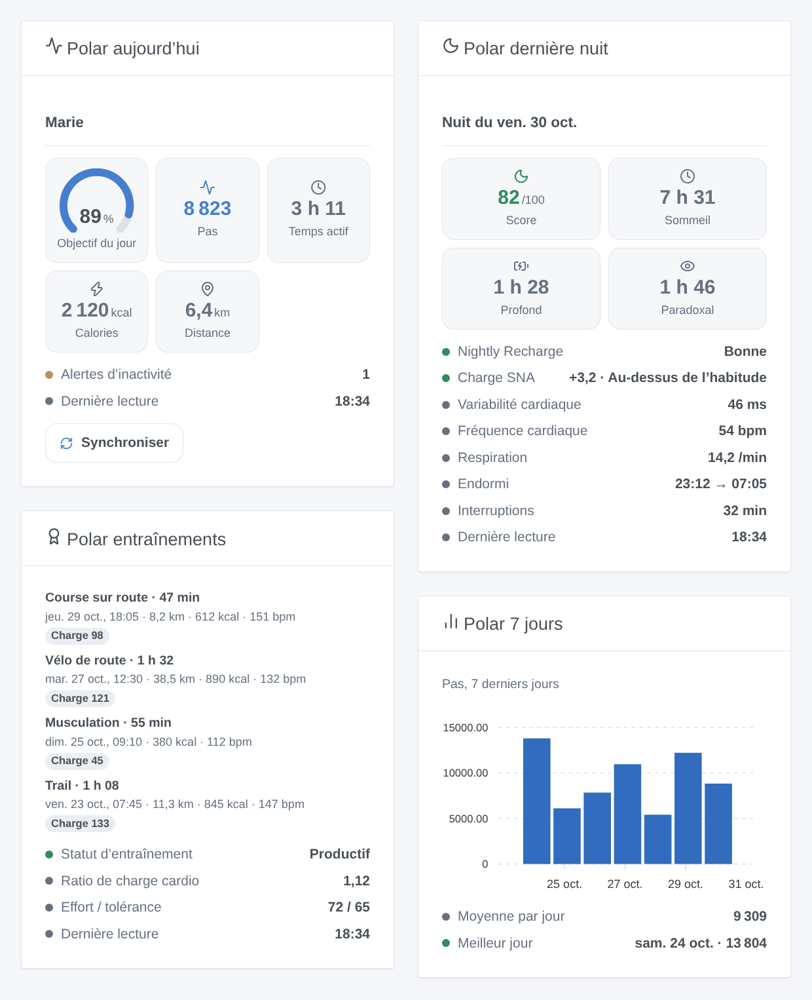
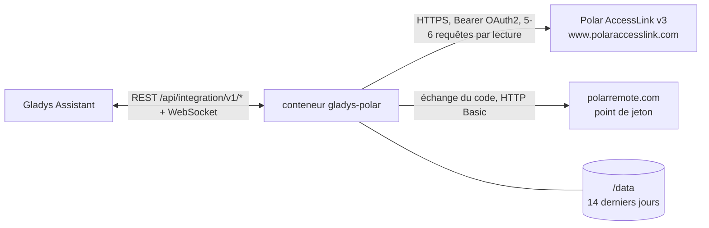
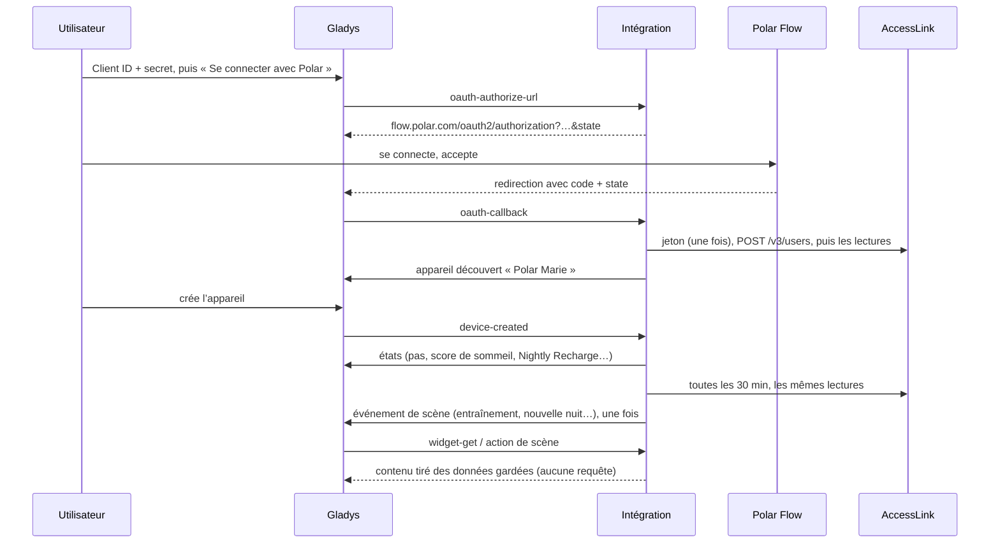

# Gladys Polar

[English](README.md) · **Français** · [Deutsch](README.de.md) · [Español](README.es.md)

[](LICENSE)
[](https://github.com/William-De71/gladys-polar/releases)
[](https://github.com/William-De71/gladys-polar/actions/workflows/release.yml)
[](https://gladysassistant.com)


Intégration externe [Gladys Assistant](https://gladysassistant.com) pour les **montres et capteurs cardio Polar**, par l’API officielle [Polar AccessLink](https://www.polar.com/accesslink-api/) et votre propre client API. L’activité du jour, la dernière nuit, la Nightly Recharge, les entraînements et la charge cardio deviennent un appareil, des widgets et des déclencheurs de scène.

Documentation utilisateur : [English](docs/en.md) · [Français](docs/fr.md) · [Deutsch](docs/de.md) · [Español](docs/es.md).

> Intégration communautaire, sans lien avec Polar Electro, ni approuvée ni soutenue par elle. Polar, Polar Flow et Nightly Recharge sont des marques de Polar Electro Oy. Pas encore testée avec un vrai compte Polar : la forme de chaque réponse vient de la documentation AccessLink.

## Fonctionnalités

- **Un appareil par compte Polar Flow lié** : pas, temps actif, calories, distance et objectif du jour ; score et durée de sommeil ; statut Nightly Recharge, charge SNA, variabilité cardiaque, fréquence cardiaque et respiratoire ; statut et ratio de charge cardio.
- **Quatre widgets** : aujourd’hui (avec un bouton de synchro), dernière nuit, entraînements, sept derniers jours.
- **Quatre déclencheurs** et **une action de scène** (voir plus bas).
- **OAuth 2.0 avec votre propre client AccessLink** ; le code d’autorisation n’est jamais envoyé deux fois (Polar supprime alors tous les jetons).
- **Cloud**, lu toutes les 15 à 120 minutes, limites de requêtes respectées, données gardées dans `/data`.
- Anglais, français, allemand et espagnol partout.



## Fonctionnement




L’utilisateur crée un client API sur admin.polaraccesslink.com avec l’URL de redirection de Gladys. « Se connecter avec Polar » ouvre Polar Flow ; Gladys relaie le code, et l’intégration l’échange une seule fois au point de jeton (HTTP Basic `client_id:client_secret`, sans PKCE ni jeton de rafraîchissement, un jeton valable environ un an), puis inscrit l’utilisateur auprès du client (`POST /v3/users`). Chaque lecture interroge les points non transactionnels : activité quotidienne (aujourd’hui et les 7 jours précédents), entraînements (30 jours), nuits, Nightly Recharge, charge cardio, et les infos physiques deux fois par jour. Les webhooks de Polar ne sont pas utilisés : ils exigent une URL publique qui répond au ping de Polar et des requêtes signées dont Gladys Plus ne transmet pas l’en-tête.



### Transport

Cloud uniquement (`"transports": ["cloud"]`) : le catalogue affiche le badge cloud. Vos données Polar vont des serveurs de Polar à votre Gladys par Internet, avec votre propre client ; rien ne passe par un serveur tiers. Il n’existe pas d’accès local, donc pas de bouton « Préférer la connexion locale ».

## Appareils et fonctionnalités

| Fonctionnalité                | Catégorie / type              | Unité         |
| ----------------------------- | ----------------------------- | ------------- |
| Pas du jour                   | `counter-sensor` / `integer`  | —             |
| Temps actif du jour           | `duration` / `integer`        | minutes       |
| Calories du jour (kcal)       | `counter-sensor` / `integer`  | —             |
| Distance du jour              | `distance-sensor` / `decimal` | km            |
| Objectif d’activité du jour   | `level-sensor` / `decimal`    | %             |
| Score de sommeil              | `counter-sensor` / `integer`  | —             |
| Durée de sommeil              | `duration` / `decimal`        | heures        |
| Statut Nightly Recharge (1-6) | `counter-sensor` / `integer`  | —             |
| Charge SNA (-10 à +10)        | `level-sensor` / `decimal`    | —             |
| Variabilité cardiaque (nuit)  | `duration` / `integer`        | millisecondes |
| Fréquence cardiaque nocturne  | `counter-sensor` / `integer`  | —             |
| Fréquence respiratoire        | `level-sensor` / `decimal`    | —             |
| Ratio de charge cardio        | `level-sensor` / `decimal`    | —             |
| Statut de charge cardio       | `text` / `text`               | —             |

Gladys n’a ni catégorie santé ni unité de pas, de calories, de fréquence cardiaque ou de poids : les comptes utilisent `counter-sensor` sans unité (l’unité figure dans le nom), les durées `duration`, et le poids n’est qu’une sortie de l’action de scène. L’identifiant de l’appareil vient de l’identifiant utilisateur Polar (`x_user_id`), jamais d’un nom.

## Déclencheurs, actions et widgets

| Type        | Clé                          | Usage                                                             |
| ----------- | ---------------------------- | ----------------------------------------------------------------- |
| Déclencheur | `exercise_synced`            | un nouvel entraînement (filtre : famille de sport)                |
| Déclencheur | `sleep_available`            | la nuit des deux derniers jours, avec son score et ses phases     |
| Déclencheur | `nightly_recharge_available` | la Nightly Recharge des deux derniers jours (filtre : statut 1-6) |
| Déclencheur | `daily_goal_reached`         | 100 % de l’objectif d’activité, une fois par jour                 |
| Action      | `get_summary`                | les dernières valeurs (20 sorties, poids compris), sans requête   |
| Widget      | `today`                      | jauge d’objectif, pas, temps actif, calories, distance, synchro   |
| Widget      | `night`                      | score, durée, sommeil profond et paradoxal, Nightly Recharge      |
| Widget      | `exercises`                  | les dernières séances et le statut d’entraînement                 |
| Widget      | `week`                       | pas, temps actif ou score de sommeil des sept derniers jours      |

Exemples : **nouvelle nuit** → envoyer le résumé sur votre téléphone ; **Nightly Recharge** statut 1 ou 2 → lumières du matin plus douces ; **entraînement synchronisé** (course) → allumer le sèche-serviettes.

## Prérequis

- Gladys Assistant **5.3.0** ou plus récent (mots-clés du catalogue de Gladys 5.3, widgets et scènes des intégrations externes). Les instances plus anciennes ne peuvent pas installer l’intégration.
- Un compte Polar Flow et un appareil Polar qui s’y synchronise.
- Un client API AccessLink gratuit créé sur [admin.polaraccesslink.com](https://admin.polaraccesslink.com), avec `https://my.gladysassistant.com/redirect/oauth` comme URL de redirection.

## Installation

- **Depuis le store** de Gladys (Intégrations → Intégrations externes), en un clic, une fois indexée.
- **Depuis l’URL du dépôt** : `https://github.com/William-De71/gladys-polar`.
- **Mode développeur** : construisez l’image en local (`docker build -t gladys-polar .`) et installez-la depuis Gladys.

## Configuration

| Champ                   | Description                                                                                 |
| ----------------------- | ------------------------------------------------------------------------------------------- |
| Client ID               | Le Client ID de votre client AccessLink.                                                    |
| Client secret           | Son secret (champ secret, jamais journalisé).                                               |
| Se connecter avec Polar | Lie le compte (portée `accesslink.read_all`, lecture seule).                                |
| Intervalle de lecture   | 15, 30 (par défaut), 60 ou 120 minutes.                                                     |
| Langue des textes       | Noms de l’appareil, statut de charge cardio et résumés des scènes (auto : tableau de bord). |

Boutons : **Synchroniser maintenant**, **Délier le compte Polar** (`DELETE /v3/users/{id}`, le jeton est oublié) et **Diagnostic** (écrit un état anonymisé dans l’onglet Journaux).

## Utilisation

1. Créez le client AccessLink, collez son Client ID et son secret, enregistrez, cliquez sur **Se connecter avec Polar**.
2. Dans l’onglet **Découverte**, créez l’appareil « Polar … ».
3. Synchronisez la montre avec Polar Flow (Polar ne partage que ce qui est synchronisé après la liaison), ajoutez les widgets à un tableau de bord et créez vos scènes.

## Développement

```bash
npm install
npm test                       # node --test, sans jamais toucher au réseau
npm run lint && npm run format:check
npx github:GladysAssistant/integration-store . --skip-image-check
scripts/build-cover.sh         # cover.jpg depuis docs/assets/cover.svg
docs/illustrations/render.sh   # docs/assets/widgets.<lang>.png
node .github/scripts/release.mjs next
```

En local, le SDK lit `GLADYS_HOST_API_URL`, `GLADYS_INTEGRATION_TOKEN` et `GLADYS_INTEGRATION_SELECTOR` ; `TZ` fixe « aujourd’hui ». `DEBUG=gladys-integration-sdk` affiche les journaux du SDK et vérifie chaque contenu de widget. Les tests utilisent un faux Polar et des réponses inventées calquées sur la documentation (`test/helpers/`). Les règles du projet sont dans [CLAUDE.md](CLAUDE.md).

## Processus de release


Chaque fusion sur `main` lance la CI, puis calcule la version d’après les [Conventional Commits](https://www.conventionalcommits.org/) depuis le dernier tag : `feat` → mineure, `fix` / `perf` → correctif, `!` ou `BREAKING CHANGE` → majeure (mineure avant 1.0.0). `docs`, `chore`, `ci`, `test`, `style`, `refactor` et `build` seuls ne publient rien. Le workflow génère ensuite la section du changelog, pousse le tag et construit l’image multi-architecture. Ensuite seulement, `main` reçoit le commit de release et la GitHub Release est créée. Un dernier job vérifie l’image publique, le validateur du store et le topic.

- Le titre de la pull request devient le commit squash, puis la ligne du changelog : rédigez-le en anglais, pour l’utilisateur (`pr-title.yml` le vérifie). Ne modifiez jamais `CHANGELOG.md` à la main.
- La 1.0.0 est une décision : Actions → Release → Run workflow avec `release-as: 1.0.0`. `dry-run` affiche la version et les notes sans rien publier.
- **Branche protégée** : la release pousse son commit sur `main` avec `GITHUB_TOKEN`. Avec un ruleset sur `main` plus strict que « ni suppression ni force-push », ajoutez GitHub Actions à sa liste de contournement (ou poussez via une GitHub App). Sinon le job de publication échoue en expliquant quoi faire.
- Après la première release, rendez public le package `ghcr.io` (Package settings → Change visibility), sinon Gladys ne peut pas le télécharger.

## Dépannage

Voir [docs/fr.md](docs/fr.md#dépannage). Signalez un problème avec les versions de Gladys et de l’intégration, le modèle de montre et les lignes du bouton **Diagnostic**.

## Contribuer

Issues et pull requests bienvenues. Lancez `npm run format:check && npm run lint && npm test` avant d’ouvrir une pull request, et gardez inchangés tous les identifiants externes et clés stockées (voir [CLAUDE.md](CLAUDE.md)). Une vraie réponse d’AccessLink qui diffère de la documentation est très bienvenue comme nouveau cas de test (retirez d’abord noms et identifiants).

## Sécurité

Voir [SECURITY.md](SECURITY.md) : signalez les vulnérabilités en privé. Le secret du client est un champ secret ; le jeton et l’état OAuth sont des clés de configuration internes, jamais écrites dans `/data` ni dans les journaux. Un code d’autorisation n’est jamais envoyé deux fois à Polar.

## Captures à venir

Les images ci-dessus sont des illustrations, pas des captures d’écran. Les vraies captures iront dans `docs/assets/screenshots/` (PNG, 1280 × 800) : `configuration.png`, `discovery.png`, `device.png`, `scene.png`.

## Licence

[Licence Apache 2.0](LICENSE) — voir aussi [NOTICE](NOTICE). Les données viennent de votre compte Polar Flow par l’API Polar AccessLink, selon les conditions AccessLink de Polar. Merci à la documentation et au SDK de Gladys.
