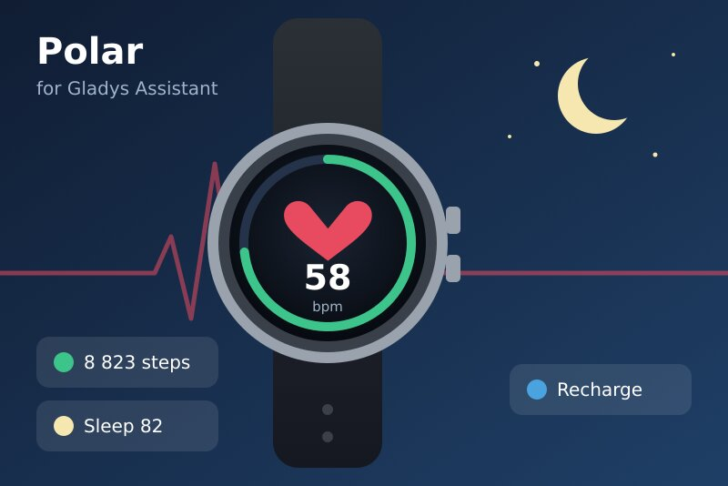
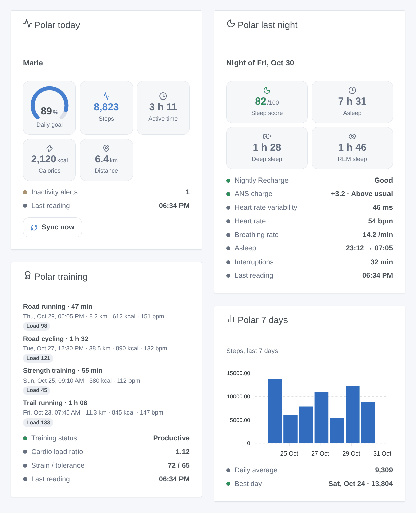
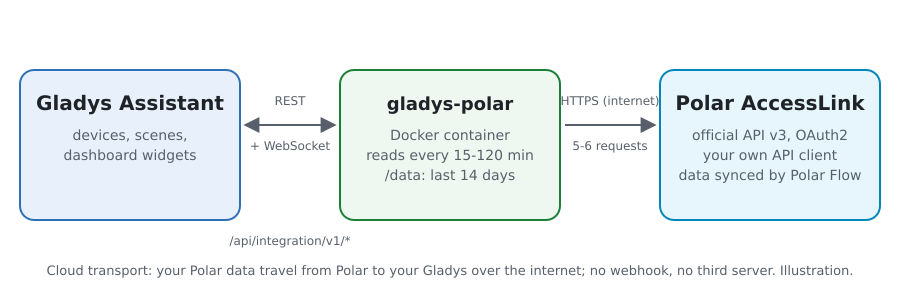
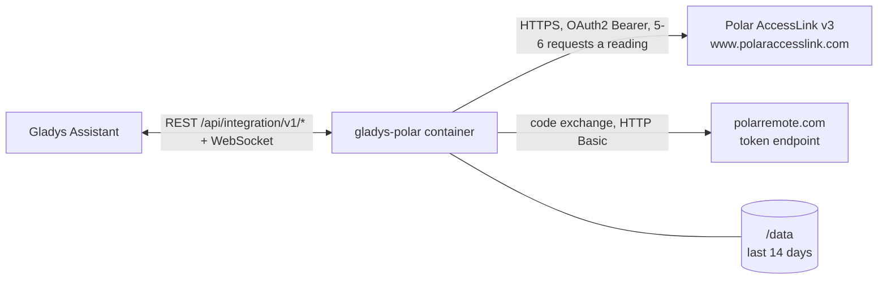
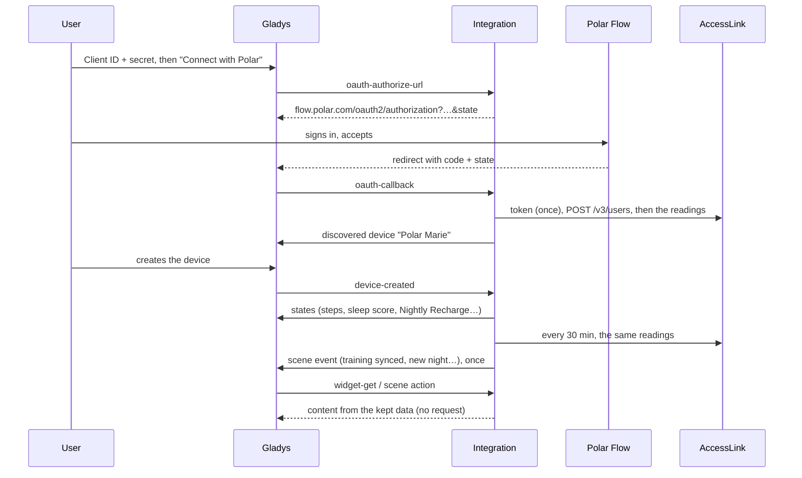

# Gladys Polar

**English** · [Français](README.fr.md) · [Deutsch](README.de.md) · [Español](README.es.md)

[](LICENSE)
[](https://github.com/William-De71/gladys-polar/releases)
[](https://github.com/William-De71/gladys-polar/actions/workflows/release.yml)
[](https://gladysassistant.com)



[Gladys Assistant](https://gladysassistant.com) external integration for **Polar watches and heart rate sensors**, through the official [Polar AccessLink](https://www.polar.com/accesslink-api/) API and your own API client. Today's activity, last night, Nightly Recharge, training sessions and cardio load become a device, dashboard widgets and scene triggers.

User documentation: [English](docs/en.md) · [Français](docs/fr.md) · [Deutsch](docs/de.md) · [Español](docs/es.md).

> Community integration, not affiliated with, endorsed or sponsored by Polar Electro. Polar, Polar Flow and Nightly Recharge are trademarks of Polar Electro Oy. Never tested with a real Polar account so far: every answer shape comes from the AccessLink documentation.

## Features

- **One device per linked Polar Flow account**: steps, active time, calories, distance and daily goal of the day; sleep score and time asleep; Nightly Recharge status, ANS charge, heart rate variability, heart rate and breathing rate; cardio load status and ratio.
- **Four widgets**: today (with a sync button), last night, training sessions, last seven days.
- **Four scene triggers** and **one scene action** (see below).
- **OAuth 2.0 with your own AccessLink client**; the authorization code is never sent twice (Polar deletes every token when it is).
- **Cloud**, read every 15 to 120 minutes, rate limits respected, data kept in `/data`.
- English, French, German and Spanish everywhere.



## How it works





The user creates an API client on admin.polaraccesslink.com with the redirect URL of Gladys. "Connect with Polar" opens Polar Flow; Gladys relays the code back, and the integration exchanges it once at the token endpoint (HTTP Basic `client_id:client_secret`, no PKCE, no refresh token, a token valid about a year), then registers the user to the client (`POST /v3/users`). Each reading asks the non-transactional endpoints: daily activity (today and the 7 days before), training sessions (30 days), nights, Nightly Recharge, cardio load, and the physical info twice a day. Polar's webhooks are not used: they need a public URL answering Polar's ping and signed requests whose header Gladys Plus does not relay.



### Transport

Cloud only (`"transports": ["cloud"]`): the catalog shows the cloud badge. Your Polar data travel from Polar's servers to your Gladys over the internet, with your own client; nothing goes through a third server. There is no local alternative, so there is no "prefer the local connection" button.

## Devices and features

| Feature                        | Category / type               | Unit         |
| ------------------------------ | ----------------------------- | ------------ |
| Steps today                    | `counter-sensor` / `integer`  | —            |
| Active time today              | `duration` / `integer`        | minutes      |
| Calories today (kcal)          | `counter-sensor` / `integer`  | —            |
| Distance today                 | `distance-sensor` / `decimal` | km           |
| Daily activity goal            | `level-sensor` / `decimal`    | %            |
| Sleep score                    | `counter-sensor` / `integer`  | —            |
| Time asleep                    | `duration` / `decimal`        | hours        |
| Nightly Recharge status (1-6)  | `counter-sensor` / `integer`  | —            |
| ANS charge (-10 to +10)        | `level-sensor` / `decimal`    | —            |
| Heart rate variability (night) | `duration` / `integer`        | milliseconds |
| Heart rate at night (bpm)      | `counter-sensor` / `integer`  | —            |
| Breathing rate (per minute)    | `level-sensor` / `decimal`    | —            |
| Cardio load ratio              | `level-sensor` / `decimal`    | —            |
| Cardio load status             | `text` / `text`               | —            |

Gladys has no health category and no step, calorie, heart rate or weight unit: counts use `counter-sensor` without unit (the unit is in the name), durations use `duration`, and the weight is only an output of the scene action. The device id comes from the Polar user id (`x_user_id`), never from a name.

## Scene triggers, actions and widgets

| Kind    | Key                          | Use                                                            |
| ------- | ---------------------------- | -------------------------------------------------------------- |
| Trigger | `exercise_synced`            | a new training session (filter: sport family)                  |
| Trigger | `sleep_available`            | the night of the last two days, with its score and stages      |
| Trigger | `nightly_recharge_available` | the Nightly Recharge of the last two days (filter: status 1-6) |
| Trigger | `daily_goal_reached`         | 100 % of the daily activity goal, once a day                   |
| Action  | `get_summary`                | the latest values (20 outputs, weight included), no request    |
| Widget  | `today`                      | daily goal gauge, steps, active time, calories, distance, sync |
| Widget  | `night`                      | sleep score, time asleep, deep and REM sleep, Nightly Recharge |
| Widget  | `exercises`                  | the last sessions and the training status                      |
| Widget  | `week`                       | steps, active time or sleep score of the last seven days       |

Examples: **new night** → send the summary to your phone; **Nightly Recharge** status 1 or 2 → softer morning lights; **training synced** (running) → turn on the towel warmer.

## Requirements

- Gladys Assistant **5.3.0** or later (catalog keywords of Gladys 5.3, widgets and scenes of external integrations). Older instances cannot install the integration.
- A Polar Flow account and a Polar device that syncs with it.
- A free AccessLink API client created on [admin.polaraccesslink.com](https://admin.polaraccesslink.com), with `https://my.gladysassistant.com/redirect/oauth` as redirect URL.

## Installation

- **From the store** of Gladys (Integrations → External integrations), in one click, once indexed.
- **From the repository URL**: `https://github.com/William-De71/gladys-polar`.
- **Developer mode**: build the image locally (`docker build -t gladys-polar .`) and install it from Gladys.

## Configuration

| Field                 | Description                                                                       |
| --------------------- | --------------------------------------------------------------------------------- |
| Client ID             | The Client ID of your AccessLink client.                                          |
| Client secret         | Its secret (a secret field, never logged).                                        |
| Connect with Polar    | Links the account (scope `accesslink.read_all`, read only).                       |
| Reading interval      | 15, 30 (default), 60 or 120 minutes.                                              |
| Language of the texts | Device names, cardio load status and scene summaries (automatic: your dashboard). |

Buttons: **Sync now**, **Unlink the Polar account** (`DELETE /v3/users/{id}`, the token is forgotten) and **Diagnostic** (writes an anonymized state to the Logs tab).

## Usage

1. Create the AccessLink client, paste its Client ID and secret, save, click **Connect with Polar**.
2. In the **Discover** tab, create the "Polar …" device.
3. Sync the watch with Polar Flow (Polar only shares what is synced after the link), add the widgets to a dashboard and build scenes.

## Development

```bash
npm install
npm test                       # node --test, never touches the network
npm run lint && npm run format:check
npx github:GladysAssistant/integration-store . --skip-image-check
scripts/build-cover.sh         # cover.jpg from docs/assets/cover.svg
docs/illustrations/render.sh   # docs/assets/widgets.<lang>.png
node .github/scripts/release.mjs next
```

Locally, the SDK reads `GLADYS_HOST_API_URL`, `GLADYS_INTEGRATION_TOKEN` and `GLADYS_INTEGRATION_SELECTOR`; `TZ` sets "today". `DEBUG=gladys-integration-sdk` shows the SDK logs and checks every widget content. The tests use a fake Polar and made-up answers shaped like the documentation (`test/helpers/`). The rules of the project are in [CLAUDE.md](CLAUDE.md).

## Release process


Every merge on `main` runs the CI, then computes the version from the [Conventional Commits](https://www.conventionalcommits.org/) since the last tag: `feat` → minor, `fix` / `perf` → patch, `!` or `BREAKING CHANGE` → major (a minor below 1.0.0). `docs`, `chore`, `ci`, `test`, `style`, `refactor` and `build` alone publish nothing. The workflow then generates the changelog section, pushes the tag and builds the multi-architecture image. After that, `main` receives the release commit and the GitHub Release is created. A last job checks the public image, the store validator and the topic.

- The pull request title becomes the squash commit, then the changelog line: write it in English, for the user (`pr-title.yml` checks it). Never edit `CHANGELOG.md` by hand.
- 1.0.0 is a decision: Actions → Release → Run workflow with `release-as: 1.0.0`. `dry-run` shows the version and the notes without publishing.
- **Protected branch**: the release pushes its commit to `main` with `GITHUB_TOKEN`. With a ruleset on `main` stricter than "no deletion, no force push", add GitHub Actions to its bypass list (or push through a GitHub App). Otherwise the publish job fails with instructions.
- After the first release, make the `ghcr.io` package public (Package settings → Change visibility), or Gladys cannot pull it.

## Troubleshooting

See [docs/en.md](docs/en.md#troubleshooting). Report issues with the versions of Gladys and of the integration, the watch model, and the lines of the **Diagnostic** button.

## Contributing

Issues and pull requests are welcome. Run `npm run format:check && npm run lint && npm test` before opening a pull request, and keep every external id and stored key unchanged (see [CLAUDE.md](CLAUDE.md)). A real answer of AccessLink that differs from the documentation is very welcome as a new test case (remove names and ids first).

## Security

See [SECURITY.md](SECURITY.md): report vulnerabilities privately. The client secret is a secret field; the token and the OAuth state are internal configuration keys, never written to `/data` nor to the logs. An authorization code is never sent twice to Polar.

## Screenshots to come

The images above are illustrations, not screenshots. Real screenshots will go in `docs/assets/screenshots/` (PNG, 1280 × 800): `configuration.png`, `discovery.png`, `device.png`, `scene.png`.

## License

[Apache License 2.0](LICENSE) — see also [NOTICE](NOTICE). The data come from your Polar Flow account through the Polar AccessLink API, under Polar's AccessLink terms. Thanks to the Gladys documentation and SDK.
